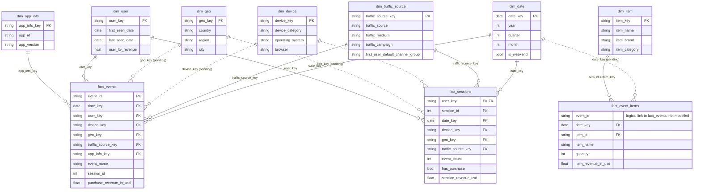

# 4. Data Dictionary — GA4 Marketing Dashboard semantic model

Star schema built on the GA4 BigQuery export, loaded into Power BI in **Import** mode.

**How to read this**
- **Type** column = BigQuery type (Power BI maps it: STRING → Text, INT64 → Whole number, FLOAT64 → Decimal, DATE → Date, BOOL → True/False).
- **Key**: `PK` primary key, `FK` foreign key (the column that carries a relationship), `—` none.
- Status legend for relationships: ✅ confirmed in the model · ⏳ defined but blocked/pending · 🔍 defined in the design, not re-checked (see §7 to verify).
- §6 lists where the **loaded Power BI model differs from the repo SQL**. Read it before trusting column counts.

---

## 1. Model at a glance

| Table | Role | Grain (one row per…) | Primary key | Built from (BigQuery) |
|---|---|---|---|---|
| `fact_events` | **Fact** | GA4 event | `event_id` | `flatten_events` → physical table |
| `fact_sessions` | **Fact** | session | `user_key` + `session_id` (composite) | view over `fact_events` |
| `fact_event_items` | **Fact** | item line within an event | none guaranteed (`event_id` + `item_id` identifies a line) | view over `flatten_event_items` |
| `dim_date` | **Dimension** | calendar day | `date_key` | generated calendar; marked as the model's Date table |
| `dim_device` | **Dimension** | device combination | `device_key` | rebuilt from `fact_events` |
| `dim_geo` | **Dimension** | continent/country/region/city combination | `geo_key` | rebuilt from `fact_events` |
| `dim_traffic_source` | **Dimension** | first-touch source/medium/campaign combination | `traffic_source_key` | rebuilt from `fact_events` |
| `dim_app_info` | **Dimension** | app id + version | `app_info_key` | rebuilt from `fact_events` (empty for web-only data) |
| `dim_item` | **Dimension** | product | `item_key` | rebuilt from `flatten_event_items` |
| `dim_user` | **Dimension** | user (device/browser id) | `user_key` | rebuilt from `fact_events` |
| `KPI Selector` | Parameter (disconnected) | selectable KPI | `KPI Selector Order` | calculated table (field parameter) |
| `#_Measures_` | Measure container | — (no columns) | — | DAX measures only |

Sample data loaded: **1 Nov 2020 – 31 Jan 2021**; at last check `fact_events` had 4,295,584 rows and `fact_sessions` 360,129 rows.

Not loaded into Power BI (kept in BigQuery only, on purpose — millions of rows): `bridge_event_params` (one row per event parameter) and `bridge_user_properties` (one row per user property).

---

## 2. Relationships

All relationships: **many-to-one (fact → dimension), single-direction filtering**, active.

| # | From (many) | To (one) | Status |
|---|---|---|---|
| 1 | `fact_events[date_key]` | `dim_date[date_key]` | ✅ |
| 2 | `fact_sessions[date_key]` | `dim_date[date_key]` | ✅ |
| 3 | `fact_event_items[date_key]` | `dim_date[date_key]` | ⏳ column missing until the table is re-imported (§6) |
| 4 | `fact_events[traffic_source_key]` | `dim_traffic_source[traffic_source_key]` | ✅ |
| 5 | `fact_sessions[traffic_source_key]` | `dim_traffic_source[traffic_source_key]` | ✅ |
| 6 | `fact_events[device_key]` | `dim_device[device_key]` | ⏳ blocked: loaded `dim_device` has duplicate keys until refreshed |
| 7 | `fact_sessions[device_key]` | `dim_device[device_key]` | ⏳ same |
| 8 | `fact_events[geo_key]` | `dim_geo[geo_key]` | ⏳ blocked: loaded `dim_geo` has duplicate keys until refreshed |
| 9 | `fact_sessions[geo_key]` | `dim_geo[geo_key]` | ⏳ same |
| 10 | `fact_events[user_key]` | `dim_user[user_key]` | 🔍 |
| 11 | `fact_sessions[user_key]` | `dim_user[user_key]` | 🔍 |
| 12 | `fact_events[app_info_key]` | `dim_app_info[app_info_key]` | 🔍 (table is empty for web-only data) |
| 13 | `fact_event_items[item_id]` | `dim_item[item_key]` | 🔍 |

**Rules**
- **No relationship between the three fact tables.** They connect only through the shared dimensions. `fact_event_items[event_id]` points logically at `fact_events[event_id]`, but a fact-to-fact relationship would make filter propagation ambiguous, so it is deliberately not modelled.
- `dim_user` is not used by the User Acquisition page; relationships 10–11 are optional (they add model size, since `user_key` is high-cardinality).
- `KPI Selector` and `#_Measures_` have no relationships.

---

## 3. ERD (Mermaid)

Solid line = relationship ✅/🔍 in the design · dotted line = ⏳ pending. Only key columns and a few representative attributes are drawn; full column lists are in §4.



---

## 4. Tables and columns

### 4.1 `fact_events` — Fact · grain: one row per GA4 event · PK: `event_id`

The atomic table of the whole model. 66 columns.

**Keys and time**

| Column | Type | Key | Description |
|---|---|---|---|
| `event_id` | STRING | PK | Unique, stable hash of user id, event name, event timestamp, bundle sequence id and a tiebreaker row number. |
| `date_key` | DATE | FK → `dim_date` | Event date in the GA4 property's reporting time zone. |
| `event_timestamp` | INT64 | — | Event time, microseconds since the Unix epoch (UTC). |
| `event_previous_timestamp` | INT64 | — | Time the user last triggered this same event, microseconds. |
| `event_name` | STRING | — | GA4 event name, e.g. `page_view`, `purchase`, `first_visit`. |
| `event_value_in_usd` | FLOAT64 | — | Event value converted to USD, if the event carried one. |
| `event_bundle_sequence_id` | INT64 | — | Sequence id of the upload bundle that delivered the event. |
| `event_server_timestamp_offset` | INT64 | — | Microseconds between client collection and server receipt. |

**User and consent**

| Column | Type | Key | Description |
|---|---|---|---|
| `user_key` | STRING | FK → `dim_user` | GA4 `user_pseudo_id`: anonymous device/browser identifier. |
| `user_id` | STRING | — | Your own User-ID, if sent. Usually NULL. |
| `user_first_touch_timestamp` | INT64 | — | Microsecond timestamp of the user's first visit. |
| `user_ltv_revenue` | FLOAT64 | — | Lifetime revenue GA4 attributes to the user (often NULL on web). |
| `user_ltv_currency` | STRING | — | Currency of `user_ltv_revenue`. |
| `analytics_storage` | STRING | — | Analytics consent state (Yes/No). |
| `ads_storage` | STRING | — | Ads consent state (Yes/No). |
| `uses_transient_token` | STRING | — | Whether a transient token was used in place of a user id. |

**Dimension keys** (MD5 hashes computed once in `flatten_events`; the attributes are hashed with a `|` separator)

| Column | Type | Key | Description |
|---|---|---|---|
| `device_key` | STRING | FK → `dim_device` | Hash of device category, brand, operating system and browser. |
| `geo_key` | STRING | FK → `dim_geo` | Hash of continent, country, region and city. |
| `traffic_source_key` | STRING | FK → `dim_traffic_source` | Hash of first-touch medium, campaign and source. |
| `app_info_key` | STRING | FK → `dim_app_info` | Hash of app id and version. NULL on web events. |

**Device attributes** (kept on the fact so dimensions can be rebuilt from it)

| Column | Type | Description |
|---|---|---|
| `device_category` | STRING | `desktop`, `mobile` or `tablet`. |
| `mobile_brand_name` | STRING | Device manufacturer. |
| `mobile_model_name` | STRING | Device model. |
| `mobile_marketing_name` | STRING | Marketing name of the device. |
| `operating_system` | STRING | OS name. |
| `operating_system_version` | STRING | OS version. |
| `language` | STRING | Device/browser language setting. |
| `is_limited_ad_tracking` | STRING | Limited ad tracking flag (Yes/No). |
| `browser` | STRING | Browser name (web). |
| `browser_version` | STRING | Browser version (web). |

**Geography**

| Column | Type | Description |
|---|---|---|
| `continent` | STRING | Continent of the user. |
| `sub_continent` | STRING | Sub-continent. |
| `country` | STRING | Country. |
| `region` | STRING | Region / state. |
| `city` | STRING | City. |
| `metro` | STRING | Metro area. |

**App and stream**

| Column | Type | Description |
|---|---|---|
| `app_id` | STRING | App package / bundle id. NULL on web. |
| `app_version` | STRING | App version. NULL on web. |
| `install_store` | STRING | Store the app was installed from. |
| `firebase_app_id` | STRING | Firebase app id. |
| `install_source` | STRING | Install source. |
| `stream_id` | STRING | GA4 data stream id. |
| `platform` | STRING | `WEB`, `IOS` or `ANDROID`. |
| `hostname` | STRING | Hostname the event was collected on. |

**Traffic source (first touch)** — in this export schema these describe how the **user was first acquired**, not the current session's source.

| Column | Type | Description |
|---|---|---|
| `traffic_source` | STRING | First-touch source, e.g. `google`, `(direct)`. |
| `traffic_medium` | STRING | First-touch medium, e.g. `organic`, `cpc`, `(none)`. |
| `traffic_campaign` | STRING | First-touch campaign name. |

**Ecommerce** (NULL on events that are not ecommerce events — expected)

| Column | Type | Description |
|---|---|---|
| `transaction_id` | STRING | Order id on `purchase` events. |
| `purchase_revenue_in_usd` | FLOAT64 | Purchase revenue in USD. Source of the **Purchase revenue** measure. |
| `purchase_revenue` | FLOAT64 | Purchase revenue in the original currency. |
| `refund_value_in_usd` | FLOAT64 | Refund value in USD. |
| `refund_value` | FLOAT64 | Refund value in the original currency. |
| `shipping_value_in_usd` | FLOAT64 | Shipping value in USD. |
| `shipping_value` | FLOAT64 | Shipping value in the original currency. |
| `tax_value_in_usd` | FLOAT64 | Tax value in USD. |
| `tax_value` | FLOAT64 | Tax value in the original currency. |
| `total_item_quantity` | INT64 | Total units across the event's items. |
| `unique_items` | INT64 | Number of distinct items in the event. |

**Page and session** (pulled out of `event_params`; the full parameter set stays in BigQuery's `bridge_event_params`)

| Column | Type | Description |
|---|---|---|
| `page_location` | STRING | Full page URL. |
| `page_title` | STRING | Page title. |
| `page_referrer` | STRING | Referrer URL. |
| `session_id` | INT64 | GA4 `ga_session_id`. Unique only **together with** `user_key`. NULL when consent is denied. |
| `session_number` | INT64 | The user's nth session. |
| `engagement_time_msec` | INT64 | Engagement time since the previous event, milliseconds. |
| `is_entrance` | INT64 | 1 on the session's landing event, otherwise NULL. |
| `session_engaged` | STRING | `'1'` when the session counts as engaged. |

---

### 4.2 `fact_sessions` — Fact · grain: one row per session · PK: `user_key` + `session_id`

Derived (GA4 has no native session table) by grouping `fact_events` on `(user_key, session_id)`. Sessions that span midnight stay as one row, dated by the day they started. 14 columns.

| Column | Type | Key | Description |
|---|---|---|---|
| `user_key` | STRING | PK (part), FK → `dim_user` | User of the session. |
| `session_id` | INT64 | PK (part) | GA4 session id. |
| `date_key` | DATE | FK → `dim_date` | Date of the session's first event. |
| `session_start_ts` | INT64 | — | First event time, microseconds. |
| `session_end_ts` | INT64 | — | Last event time, microseconds. |
| `session_duration_seconds` | INT64 | — | Last minus first event time, in seconds. |
| `event_count` | INT64 | — | Events in the session. |
| `has_purchase` | BOOL | — | True if the session contains a `purchase` event. |
| `session_revenue_usd` | FLOAT64 | — | Sum of `purchase_revenue_in_usd` in the session. |
| `is_engaged` | BOOL | — | True if any event had `session_engaged = '1'`. |
| `entrance_page` | STRING | — | `page_location` of the session's first event. |
| `device_key` | STRING | FK → `dim_device` | Device of the first event. |
| `geo_key` | STRING | FK → `dim_geo` | Location of the first event. |
| `traffic_source_key` | STRING | FK → `dim_traffic_source` | First-touch source of the first event. |

---

### 4.3 `fact_event_items` — Fact · grain: one row per item per event · PK: none guaranteed

Only ecommerce events (`view_item`, `add_to_cart`, `purchase`, …) have rows. GA4 does not guarantee that `event_id` + `item_id` is unique.

| Column | Type | Key | Description |
|---|---|---|---|
| `event_id` | STRING | — (logical → `fact_events`) | Event this item line belongs to. Not a modelled relationship. |
| `date_key` | DATE | FK → `dim_date` | Event date. *Repo version only — see §6.* |
| `event_timestamp` | INT64 | — | Event time, microseconds. *Repo version only — see §6.* |
| `item_id` | STRING | FK → `dim_item[item_key]` | Product id. |
| `item_name` | STRING | — | Product name. |
| `item_brand` | STRING | — | Brand. |
| `item_variant` | STRING | — | Variant (size, colour…). |
| `item_category` … `item_category5` | STRING (5 columns) | — | Category hierarchy, level 1 to 5. |
| `price_in_usd` / `price` | FLOAT64 | — | Unit price in USD / original currency. |
| `quantity` | INT64 | — | Units. |
| `item_revenue_in_usd` / `item_revenue` | FLOAT64 | — | Item revenue in USD / original currency. |
| `item_refund_in_usd` / `item_refund` | FLOAT64 | — | Item refund in USD / original currency. |
| `coupon` | STRING | — | Item-level coupon. |
| `affiliation` | STRING | — | Supplier / store affiliation. |
| `location_id` | STRING | — | Location id. |
| `item_list_id` / `item_list_name` / `item_list_index` | STRING / STRING / INT64 | — | List the item was shown in, and its position. |
| `promotion_id` / `promotion_name` | STRING | — | Promotion the item was part of. |
| `creative_name` / `creative_slot` | STRING | — | Promotion creative and slot. |

---

### 4.4 `dim_date` — Dimension · grain: one row per day · PK: `date_key`

Marked as the model's **Date table** (required for time-intelligence functions). Covers 2020-01-01 to the end of next year.

| Column | Type | Key | Description |
|---|---|---|---|
| `date_key` | DATE | PK | The day. Used by the date slicer and the chart axis. |
| `year` | INT64 | — | Calendar year. |
| `quarter` | INT64 | — | Quarter, 1–4. |
| `month` | INT64 | — | Month number, 1–12. |
| `month_name` | STRING | — | Month name. |
| `day` | INT64 | — | Day of month. |
| `day_name` | STRING | — | Weekday name. |
| `is_weekend` | BOOL | — | True for Saturday and Sunday. |

### 4.5 `dim_device` — Dimension · grain: one row per device combination · PK: `device_key`

| Column | Type | Key | Description |
|---|---|---|---|
| `device_key` | STRING | PK | Hash of category, brand, operating system and browser. |
| `device_category` | STRING | — | `desktop`, `mobile` or `tablet`. Used by the Device slicer. |
| `mobile_brand_name` | STRING | — | Manufacturer. |
| `mobile_model_name` | STRING | — | Model. |
| `mobile_marketing_name` | STRING | — | Marketing name. |
| `operating_system` | STRING | — | OS name. |
| `operating_system_version` | STRING | — | OS version. Latest value seen for the key. |
| `language` | STRING | — | Language. Latest value seen for the key. |
| `is_limited_ad_tracking` | STRING | — | Limited ad tracking flag. |
| `browser` | STRING | — | Browser name. |
| `browser_version` | STRING | — | Browser version. Latest value seen for the key. |

### 4.6 `dim_geo` — Dimension · grain: one row per location combination · PK: `geo_key`

| Column | Type | Key | Description |
|---|---|---|---|
| `geo_key` | STRING | PK | Hash of continent, country, region and city. |
| `continent` | STRING | — | Continent. |
| `sub_continent` | STRING | — | Sub-continent. Latest value seen for the key. |
| `country` | STRING | — | Country. Used by the Country slicer. |
| `region` | STRING | — | Region / state. |
| `city` | STRING | — | City. |
| `metro` | STRING | — | Metro area. Latest value seen for the key. |

### 4.7 `dim_traffic_source` — Dimension · grain: one row per first-touch combination · PK: `traffic_source_key`

| Column | Type | Key | Description |
|---|---|---|---|
| `traffic_source_key` | STRING | PK | Hash of medium, campaign and source. |
| `traffic_medium` | STRING | — | First-touch medium. |
| `traffic_campaign` | STRING | — | First-touch campaign. |
| `traffic_source` | STRING | — | First-touch source. Row field of the traffic-source table and bar charts. |
| `first_user_default_channel_group` | STRING | — | GA4-style default channel group (Direct, Organic Search, Paid Search, Referral, Email, Organic Social, …) derived in SQL from source/medium/campaign. An approximation of Google's rules. *Repo version only — see §6.* |

### 4.8 `dim_app_info` — Dimension · grain: one row per app id + version · PK: `app_info_key`

**Empty for web-only data** (including the sample dataset): `app_info_key` is NULL on every web event. It fills automatically for app properties.

| Column | Type | Key | Description |
|---|---|---|---|
| `app_info_key` | STRING | PK | Hash of app id and version. |
| `app_id` | STRING | — | App package / bundle id. |
| `app_version` | STRING | — | App version. |
| `install_store` | STRING | — | Install store. |
| `firebase_app_id` | STRING | — | Firebase app id. |
| `install_source` | STRING | — | Install source. |

### 4.9 `dim_item` — Dimension · grain: one row per product · PK: `item_key`

| Column | Type | Key | Description |
|---|---|---|---|
| `item_key` | STRING | PK | The product's `item_id`. |
| `item_name` | STRING | — | Name (most recent value seen). |
| `item_brand` | STRING | — | Brand (most recent). |
| `item_variant` | STRING | — | Variant (most recent). |
| `item_category` … `item_category5` | STRING (5 columns) | — | Category hierarchy, level 1 to 5 (most recent). |

### 4.10 `dim_user` — Dimension · grain: one row per user · PK: `user_key`

Recomputed on every refresh, so lifetime value and last-seen date are always current.

| Column | Type | Key | Description |
|---|---|---|---|
| `user_key` | STRING | PK | GA4 `user_pseudo_id`. |
| `user_id` | STRING | — | Your User-ID if sent (latest non-null). Usually NULL. |
| `first_touch_timestamp` | TIMESTAMP | — | Earliest `user_first_touch_timestamp` seen. |
| `first_seen_date` | DATE | — | First day in the **loaded** history (not before the export started). |
| `last_seen_date` | DATE | — | Last day in the loaded history. |
| `user_ltv_revenue` | FLOAT64 | — | Latest lifetime value reported. |
| `user_ltv_currency` | STRING | — | Currency of the lifetime value. |

### 4.11 `KPI Selector` — Parameter table (disconnected) · PK: `KPI Selector Order`

A **field parameter**: it powers the KPI button slicer and the line chart. 5 rows, no relationships.

| Column | Type | Key | Description |
|---|---|---|---|
| `KPI Selector` | Text | — | KPI display name (Total users, New users, Ecommerce purchases, ECVR, Purchase revenue). |
| `KPI Selector Fields` | Text | — | Internal reference to the measure the row stands for. |
| `KPI Selector Order` | Whole number | PK | 0–4. Measures such as `KPI Value` switch on this number. |

### 4.12 `#_Measures_` — Measure container

No columns and no data; it only holds measures (§5).

---

## 5. Measures (in `#_Measures_`)

**Base KPIs** — these respond to every filter on the page, including the date slicer.

| Measure | Definition |
|---|---|
| `Total users` | Distinct `fact_events[user_key]`. |
| `New users` | Distinct users with a `first_visit` or `first_open` event. |
| `Sessions` | Rows of `fact_sessions`. |
| `Ecommerce purchases` | Count of events named `purchase`. |
| `Purchase revenue` | Sum of `fact_events[purchase_revenue_in_usd]`. |
| `ECVR` | `Ecommerce purchases` ÷ `Sessions`. |
| `% of Users`, `% New Users`, `% Revenue` | Share of the total across the rows shown (traffic sources). |

**Period comparison** — the comparison is the **same number of days immediately before** the date-slicer range.

| Measure | Definition |
|---|---|
| `First Data Date` | First day with data, ignoring all filters. |
| `Period Start` / `Period End` | First / last day selected in the date slicer (readable even inside the daily axis). |
| `Period Days` | Number of days in the selected range. |
| `Comparison Start` / `Comparison End` | The previous window: `Period Start − Period Days` to `Period Start − 1`. |
| `Comparison Caption` | Text "vs. previous period". |
| `Period Range Label`, `Comparison Range Label` | The two date ranges as readable text. |
| `… (Comparison)` ×5 | The KPI over the previous window (one each for Total users, New users, Ecommerce purchases, ECVR, Purchase revenue). Blank if that window starts before `First Data Date`. |
| `… Change %` ×5 | (current − previous) ÷ previous, with ▲/▼ formatting. |

**KPI selector layer** — switch on `KPI Selector` so one set of visuals serves all five KPIs.

| Measure | Definition |
|---|---|
| `KPI Value` | Selected KPI, current period. |
| `KPI Comparison`, `KPI Comparison Value` | Selected KPI, previous period (two equivalent measures). |
| `KPI Delta` | Selected KPI's `Change %`. |
| `KPI Share of Total` | Selected KPI's share across traffic sources (blank for ECVR). |
| `KPI Chart Title`, `KPI Table Title`, `KPI Table Subtitle` | Dynamic titles. |
| `KPI Card SVG`, `KPI Card SVG Selected` | KPI card images (normal / selected state). |
| `KPI Target Bar`, `KPI Target Line Bar SVG` | Bar-with-target-line images for the table: bar = current, dashed line = previous period. |
| `</> Slicer Filter` | Helper for the slicer styling. |

---

## 6. Where the loaded model differs from the repo SQL

| Object | Loaded Power BI model | Repo SQL | Fix |
|---|---|---|---|
| `fact_event_items` | 27 columns, **no** `date_key` / `event_timestamp` | 29 columns | Refresh/re-import the table; then add relationship 3. Until then items can't be filtered by date. |
| `dim_traffic_source` | 4 columns, **no** `first_user_default_channel_group` | 5 columns | Refresh/re-import after running `CALL build_models()` in BigQuery. |
| `dim_device`, `dim_geo` | Old copies with **duplicate keys** (3,497 rows for 119 keys; 986 rows for 977 keys at last check) | One row per key | Refresh in Desktop (Home → Refresh); then create relationships 6–9. |

---

## 7. Verify against the live model

Paste into Power BI Desktop → **DAX query view** (one at a time). These return what is *actually* in your file and settle every 🔍 above.

```dax
EVALUATE INFO.VIEW.TABLES()
```

```dax
EVALUATE INFO.VIEW.COLUMNS()
```

```dax
EVALUATE INFO.VIEW.RELATIONSHIPS()
```

```dax
EVALUATE INFO.VIEW.MEASURES()
```

Quick key-quality check (rows should equal distinct keys; a difference means the relationship cannot be created):

```dax
EVALUATE
ROW (
    "dim_device rows", COUNTROWS ( dim_device ),
    "dim_device keys", DISTINCTCOUNT ( dim_device[device_key] ),
    "dim_geo rows", COUNTROWS ( dim_geo ),
    "dim_geo keys", DISTINCTCOUNT ( dim_geo[geo_key] )
)
```
